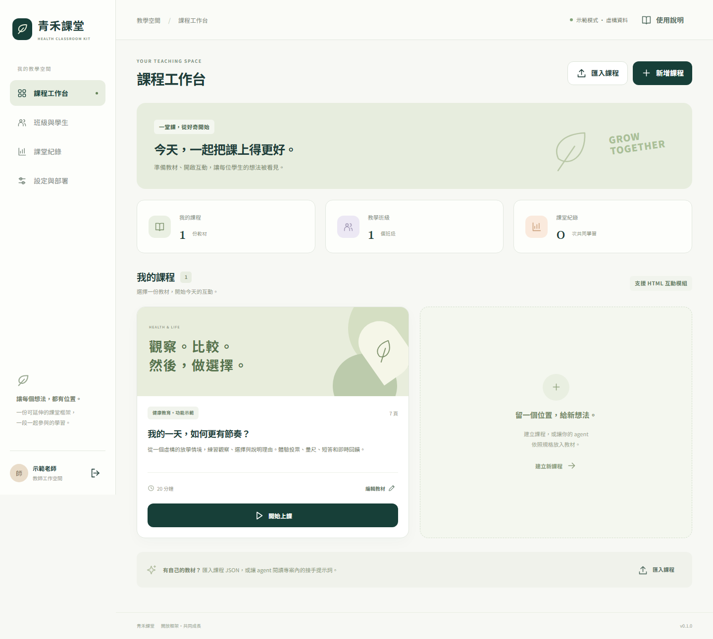
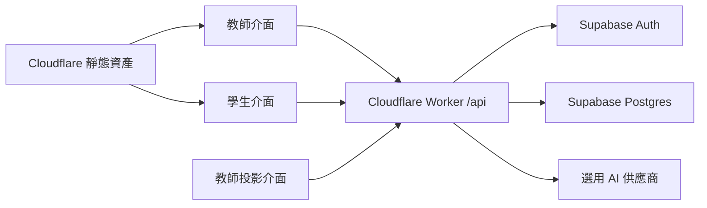

# 青禾課堂 Health Classroom Kit

**給老師與 AI agent 的互動教學框架。** 教師控場、學生作答、HTML 簡報、白板與 AI 分析共用一套資料接口。先在本機試玩，再接上自己的 Cloudflare、Supabase 和 AI API key。



*本機功能示範畫面；課程、班級與學生資料均為虛構。*

為 **教師觸控大螢幕＋學生 iPad** 設計，以柔和色彩、清楚層級與大觸控工具列呈現課程。

這個專案提供可運作的功能示範與可擴充程式，不包含正式健康課程。範例情境、班級與學生皆為虛構。AI 分析可關閉，核心授課功能不依賴 AI。

## 五分鐘開始

需要 Node.js 22.12+ 與 npm。下載 ZIP 解壓縮或 clone 專案，在專案資料夾執行：

```sh
npm ci
npm run dev
```

打開 **http://127.0.0.1:8787**。首次啟動會建置前端，再啟動本機 Worker；修改前端後重新啟動以重新建置。

| 角色 | 示範登入 |
| --- | --- |
| 教師 | 選擇「我是教師」，按「教師示範」 |
| 學生 | 班級 `DEMO801`、座號 `1`、識別碼 `DEMO01` |
| 另一位學生 | 班級 `DEMO801`、座號 `2`、識別碼 `DEMO02` |

示範班提供 1–40 號，識別碼為 `DEMO01`–`DEMO40`。使用不同瀏覽器或不同無痕工作階段扮演師生；同一瀏覽器的分頁共用登入 cookie。

班級頁可以顯示學生入口 QR Code。`127.0.0.1` 的本機網址只能在開發電腦使用；部署到自己的 HTTPS 網站後，QR Code 才會使用可讓 iPad 連入的正式網址。

**本機 demo 使用模擬資料與示範身分，不能接收真實學生資料。** 雲端模式需要另外設定，且設定失敗不會自動降級成 demo。[完整部署指南](docs/DEPLOYMENT.md)

## 先試這堂課

1. 教師登入，選擇內建課程與示範班級，開始上課。
2. 用另一個瀏覽器登入學生，等待教師開放題目後送出答案。
3. 教師切換投影片、公布統計，試用畫筆、雷射筆、聚光燈、抽籤與搶答。
4. 在教師端匯出作答 JSON／CSV，再下載課程 JSON，確認兩種檔案各自的用途。
5. 試用 AI 課程檢視／回答摘要。未設定金鑰時顯示模擬結果，畫面會標示模式。

## 框架已提供什麼

| 項目 | 內容 |
| --- | --- |
| 課程與場次 | 課程 JSON 編輯、匯入／匯出；每次上課保留教材快照 |
| 教師與學生 | 分開的操作介面；班級 QR Code；學生以班級＋座號＋識別碼登入，教師可重發識別碼 |
| IRS | 單選、多選、量尺、短答；教師控制開放與結果揭露 |
| 教學簡報 | 四種視覺化版型，可加上隔離執行的自訂 HTML |
| 課堂工具 | 白板與筆跡保存、雷射筆、聚光燈、不重複抽籤、後端裁決搶答 |
| 資料保存 | 課程、場次、作答；課程分享檔與教師備份分開 |
| AI | 教師發起的課程邏輯檢視及回答整理；秘密金鑰只留在 Worker |
| 接手文件 | 課程 schema、HTML bridge、API 契約、可複製的 agent 提示詞 |

v0.1 使用 **每 2 秒輪詢**同步課堂，不宣稱已接好 Supabase 原生 Realtime。JSON 課程編輯器是第一版教材製作介面；自由拖曳排版、多人共同編輯、影音上傳、真正匿名問卷與自動健康診斷不在本版範圍。詳細證據與尚未驗證項目見 [驗收紀錄](docs/VALIDATION.md)。

## 架構



Cloudflare 同時提供前端資產及 API；Supabase 保存正式環境資料。瀏覽器透過同網域 API 操作，AI key 和資料庫管理金鑰不會打包到前端。每位老師／學校自行部署，管理自己的資料與費用。

## 請把這些文件交給你的 agent

- **只想填教材：** [教材接手提示詞](docs/AGENT-PROMPTS.md#提示詞一填入自己的教材)
- **準備正式部署：** [部署接手提示詞](docs/AGENT-PROMPTS.md#提示詞二設定並部署到自己的帳號)、[部署指南](docs/DEPLOYMENT.md)
- **新增互動頁：** [教材格式](docs/AUTHORING.md)、[HTML 擴充接口](docs/HTML-BRIDGE.md)
- **維護與備份：** [架構與 API](docs/ARCHITECTURE.md)、[備份／還原](docs/BACKUP.md)、[隱私與安全](docs/SECURITY.md)
- **上課前：** [老師一頁指南](docs/TEACHER-QUICKSTART.md)、[大觸控螢幕與 iPad 驗收](docs/DEVICE-CHECKLIST.md)
- **看程式前：** [AGENTS.md](AGENTS.md)

## 開發與測試

```sh
npm run check
npx playwright install chromium
npm run test:e2e
```

`check` 執行 TypeScript 檢查、Node 測試及正式建置。端對端測試啟動本機示範環境，檢查真實瀏覽器流程；不需要雲端帳號或 AI 額度。測試結果不能替代部署後的跨裝置與雲端權限驗收。

## 授權

程式及本專案自行撰寫的虛構示範內容採 [MIT](LICENSE)。使用者自行加入的教材、圖片、影片及引用來源需另外確認授權；請勿把學生資料、憑證或沒有再散布權限的教材放進公開 GitHub。
